# SwiftSub

本地 Clash / Mihomo 订阅转换工作台，使用 Rust + GPUI 构建。

把机场订阅、Clash YAML、Base64 节点列表或多行节点链接转换为一份可直接使用的 Mihomo 配置，并通过本地 HTTP 地址提供给 Clash 客户端，支持自动刷新。所有数据只保存在本机，无账号、无云端、无遥测。

> 项目功能参考 [SubBoost](https://github.com/SubBoost/subboost)，但为独立实现，不复制其源码或资源。SubBoost 使用 AGPL-3.0；SwiftSub 使用 Apache-2.0。

## 截图

| 订阅源 | 配置生成 |
| --- | --- |
| 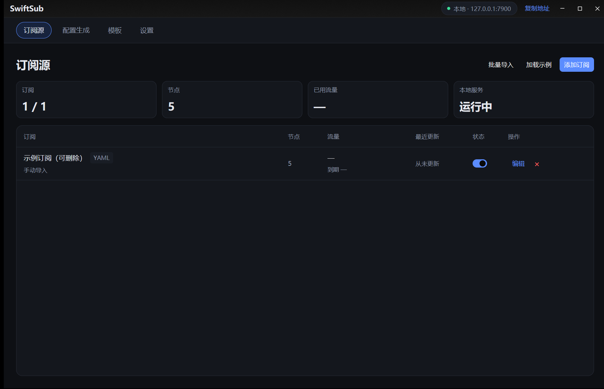 | 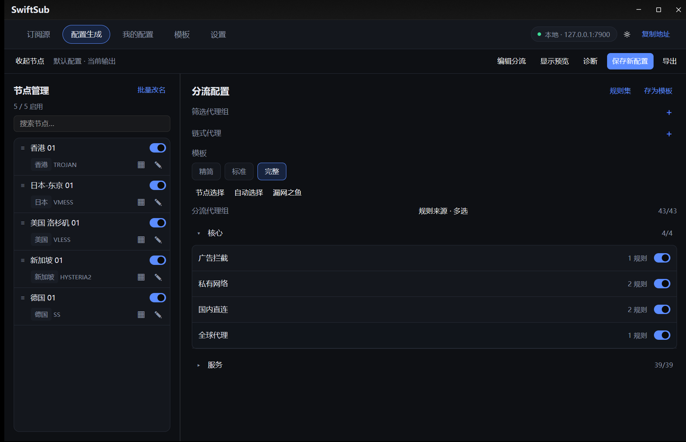 |

| 模板与分流组 | 链式代理 |
| --- | --- |
| 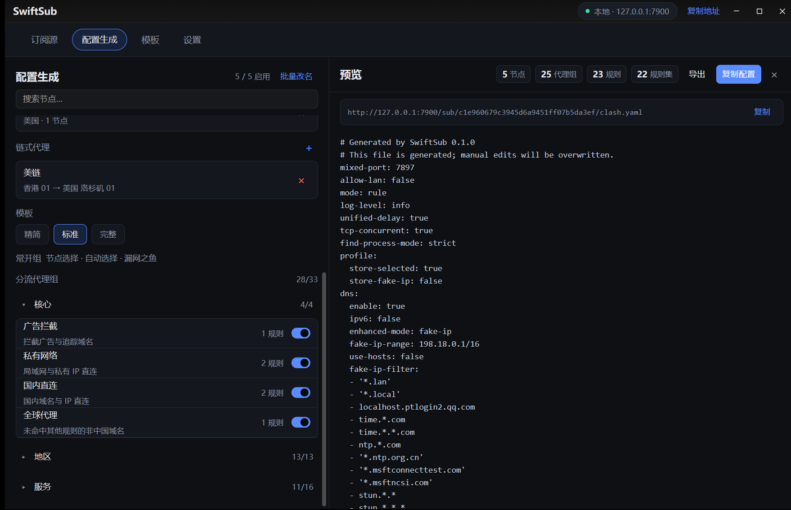 | 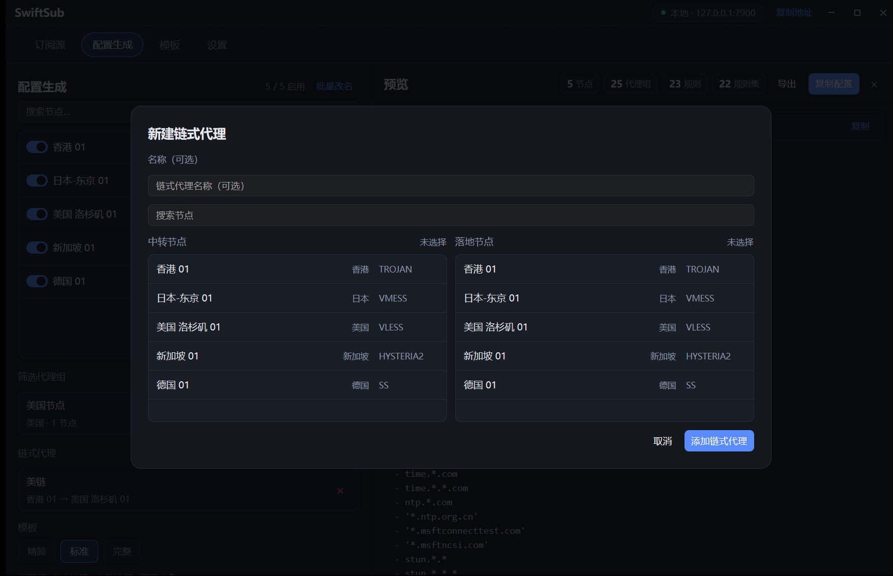 |

| 筛选代理组 | 批量导入 |
| --- | --- |
| 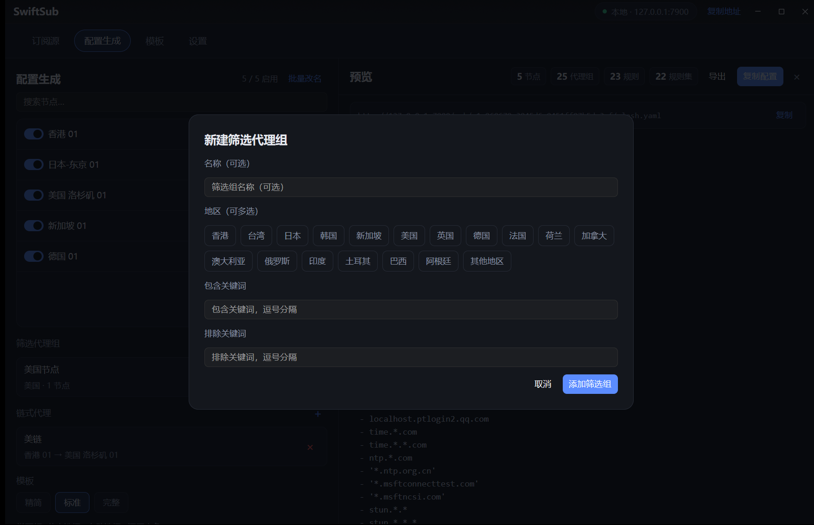 | 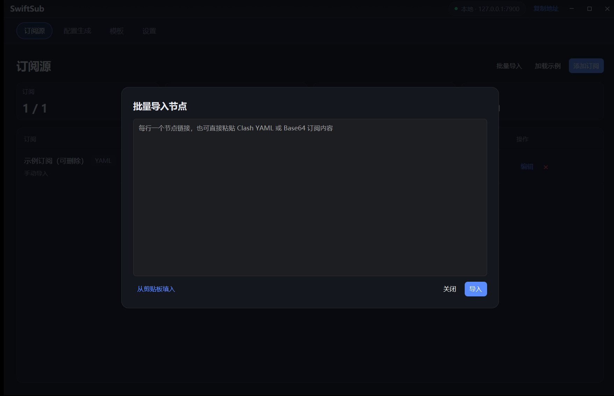 |

| 订阅详情 / 编辑 | 批量改名 |
| --- | --- |
| 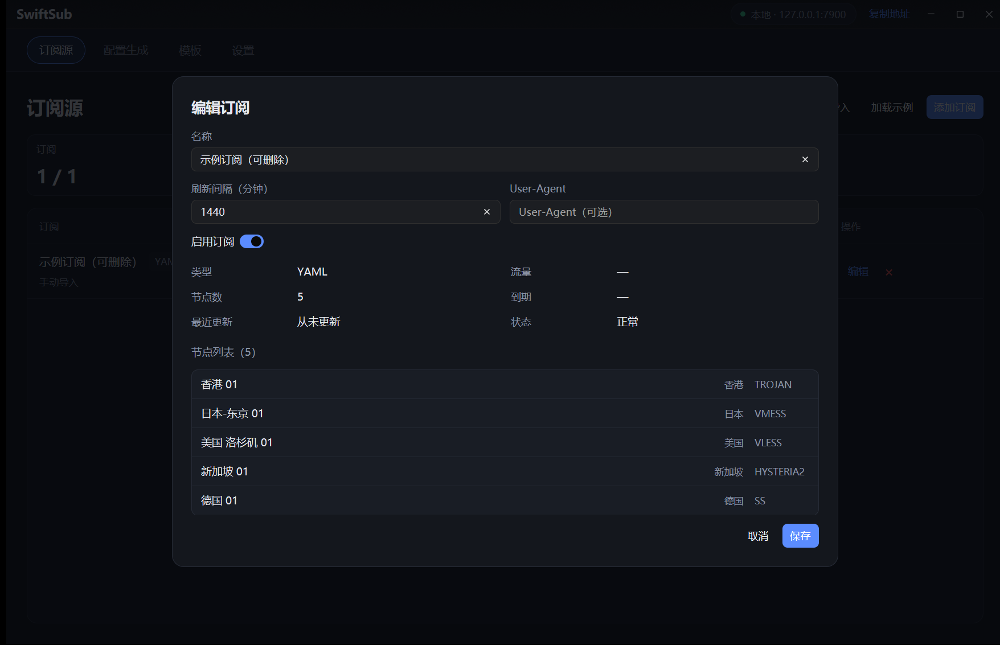 | 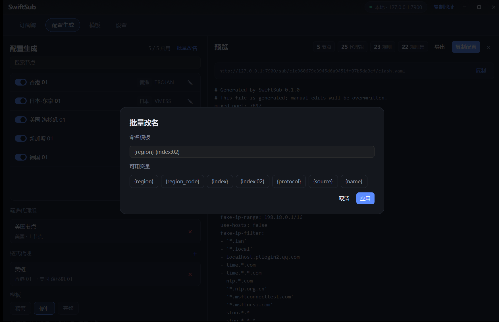 |

| 模板管理 | 浅色主题 |
| --- | --- |
| 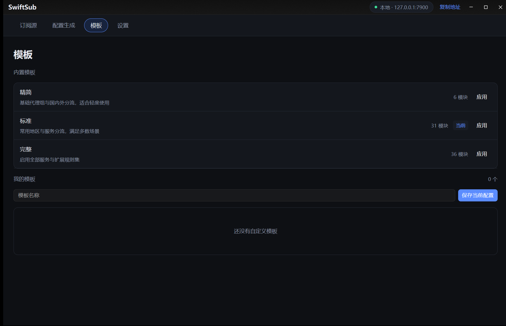 | 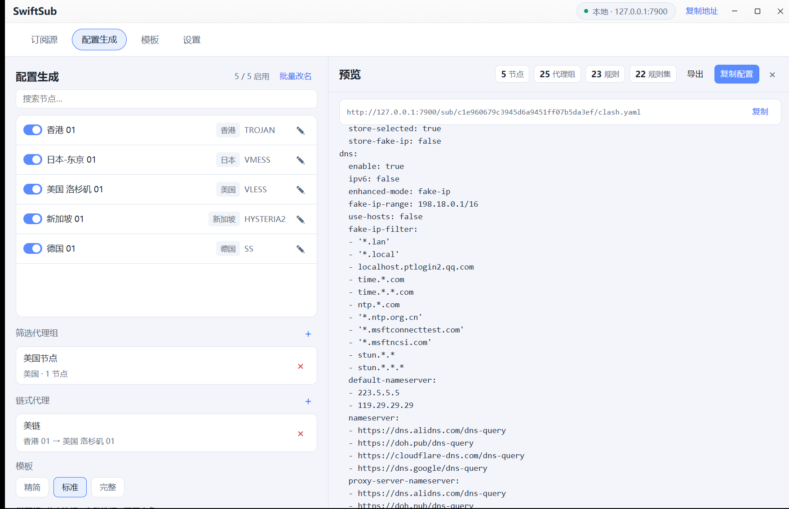 |

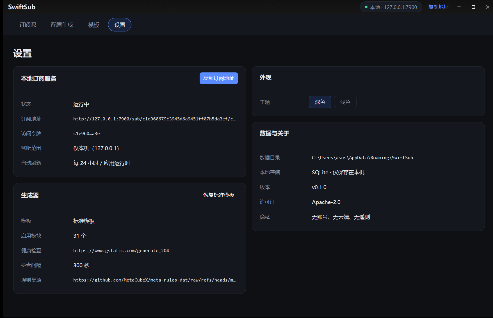

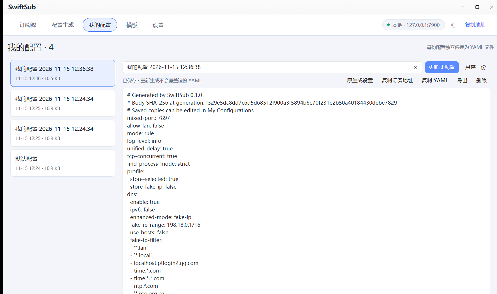

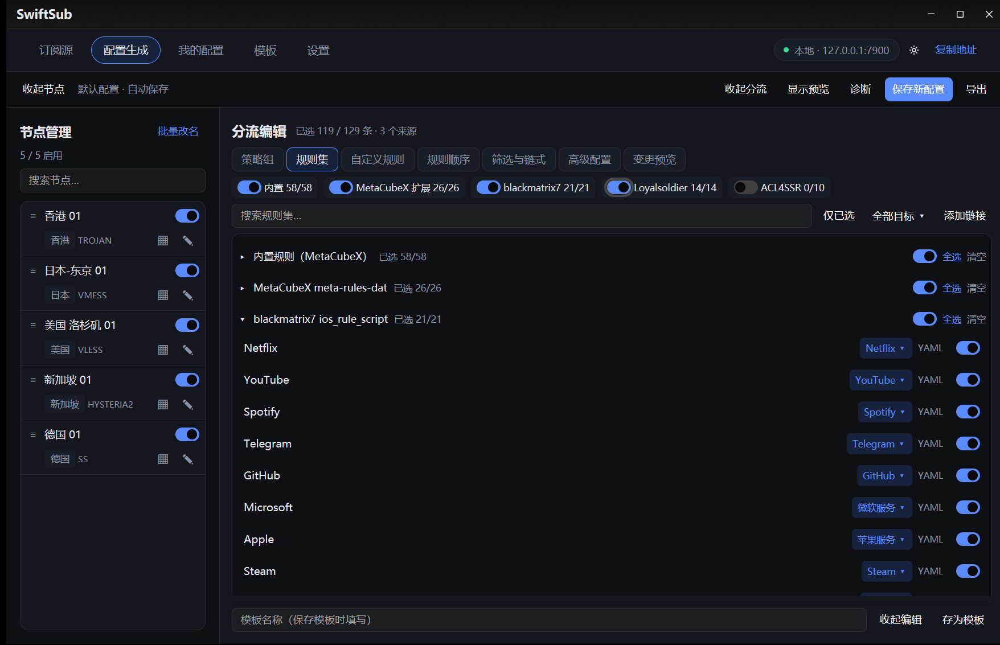

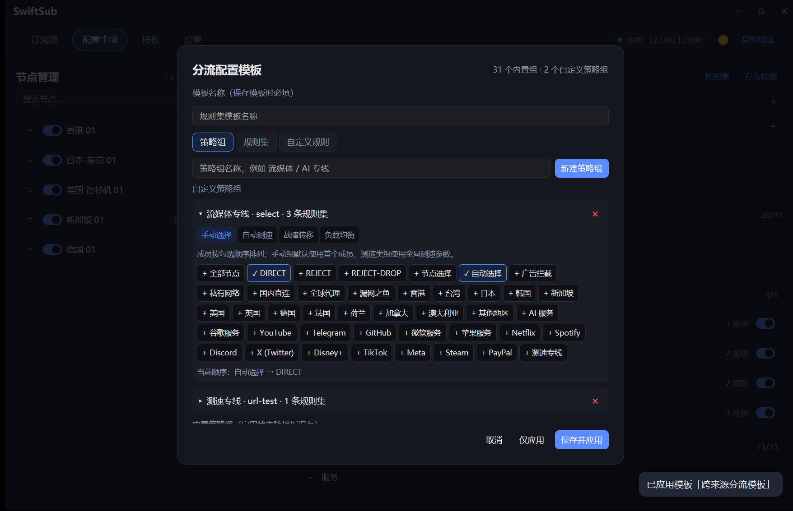

分流模板的配置方法、校验行为及与 SubBoost 的功能对照见 [分流模板说明](docs/ROUTING_TEMPLATES.md)。

## 已实现（v0.1）

- 订阅导入：HTTP/HTTPS 订阅链接、单个节点链接、剪贴板内容、本地 YAML/TXT 文件、内置示例。
- 批量导入：多行节点链接、Clash YAML、Base64 内容统一解析，导入后弹窗保持打开，可连续追加；所有手动节点累积到同一个“手动节点”源并自动去重。
- 订阅查看与编辑：可查看缓存节点列表，编辑名称、订阅链接、刷新间隔、User-Agent 和启停状态；修改链接后自动重新拉取。
- 节点编辑：双击节点名称或点击行尾铅笔，打开完整节点编辑器，可直接修改名称、协议、服务器、端口、密码等全部 YAML 字段。
- 节点排序：拖动节点行左侧“≡”手柄调整顺序，顺序会持久化并应用到生成配置。
- 批量改名：按 `{region}`、`{index:02}`、`{protocol}`、`{source}`、`{name}` 等变量批量重命名节点，并持久化。
- 协议解析：Shadowsocks、VMess、VLESS（Reality、WS、gRPC、XHTTP）、Trojan、Hysteria2、TUIC、HTTP/SOCKS；Clash YAML 中的其他协议原样透传。
- 节点处理：跨订阅去重、按地区识别、启用/禁用、搜索、实时预览。
- 筛选代理组：按地区、包含/排除关键词筛选节点，生成自定义代理组。
- 链式代理：双节点选择器兼容旧配置；高级配置支持 2–16 跳链路，通过 `dialer-proxy` 串联，缺失、重复、禁用或重名节点会阻止生成。
- 规则集：按来源折叠分类，显示各来源已选数量，可跨来源同时多选，并支持来源内全选 / 清空（搜索时仅作用于匹配项）；支持内置分组规则集单独启停，并可从 MetaCubeX、blackmatrix7、Loyalsoldier、ACL4SSR 常用规则库中选择规则集；所有来源按 GitHub / jsDelivr 镜像解析，也支持粘贴任意 `.mrs`、`.yaml`、`.txt` 规则集链接。每个规则集可路由到对应代理组或 DIRECT / REJECT，未启用的规则集不会写入配置。
- 自定义规则：模板弹窗内可按 Mihomo 语法逐行添加自定义规则（`DOMAIN-SUFFIX`、`IP-CIDR`、`GEOIP`、`MATCH` 等），随模板保存并参与生成。
- 模板：内置精简 / 标准 / 完整三套规则集模板；在生成页点击“规则集”可直接调整规则集与自定义规则，点击“存为模板”或模板页“新建模板”可命名保存。模板会保存启用分组、规则集开关、外部规则集、自定义规则、规则集来源、代理组、链式代理与生成参数，之后可一键应用或删除。
- 外观：右上角图标一键切换深色 / 浅色主题，选择会持久化。
- 布局：预览默认关闭，左侧仅显示节点，右侧显示筛选组、链式代理与分流模块；需要时再打开预览。
- 代理组选择：按核心 / 服务分类折叠，每行显示规则数量和开关，用户选择会持久化。
- 分流策略组：模板内可启停内置组、新建手动选择 / 自动测速 / 故障转移 / 负载均衡组，按顺序配置成员及全部节点；内置和外部规则集均可单独选择目标。保存与恢复覆盖组类型、成员、目标和来源，提交前检查无效引用与循环依赖。
- 配置生成：内置数据驱动模块，Mihomo 规则集（`.mrs`、YAML、text）与自定义规则，防 DNS 泄漏默认配置；MetaCubeX 镜像支持 GitHub、jsDelivr、Fastly、TestingCF，并可随规则集模板保存和恢复。
- 实时预览：YAML 预览、节点/组/规则统计、告警提示、复制、导出。
- 本地订阅服务：`127.0.0.1:7899-7905` 自动选择可用端口，Token 路径保护，返回 `Subscription-Userinfo`、`Profile-Update-Interval` 与 `ETag`；订阅文件名可自定义并同步到订阅地址。
- 自动刷新：应用运行期间按订阅间隔刷新；失败保留最后一次成功配置。
- 本地持久化：SQLite 保存订阅、节点覆盖状态、节点顺序、自定义模板、Profile 与刷新日志；可在设置中更改数据目录，重启后生效。
- 已通过 Mihomo `v1.19.34 -t` 配置校验。
- Xray 分享链接适配（2026-11-14 核对）：REALITY 默认输出 `reality-opts.support-x25519mlkem768: true`，保留链接中的显式 `false`；支持连字符、下划线和驼峰参数名，以及 `raw` / `splithttp` / `httpupgrade` 传输映射、XHTTP `mode` / `extra` / XMUX、`sessionID*` 字段和 VLESS Encryption 字符串透传。XHTTP 外层 `host/path/mode` 优先于 `extra` 同名字段；未知扩展给出提示。不支持的 VLESS 传输或非空 REALITY `pqv` 会报告导入错误，避免生成丢失关键行为的节点。

Xray / Mihomo 参数兼容范围与官方核对来源见 [链接参数适配说明](docs/LINK_COMPATIBILITY.md)。

### 扩展功能与使用位置

- 生成页「编辑分流」提供策略组详情、规则顺序拖动、来源分类多选、仅已选 / 按目标筛选、模板版本化导入导出及变更预览。
- 「高级配置」编辑 DNS、独立 mixed/http/socks 监听、2–16 跳链路、筛选组和扩展 YAML。有效修改每两秒自动校验保存，也可点击「校验配置」立即检查；监听可绑定策略组或节点，示例见 [扩展配置](docs/EXTENSIONS.md)。
- 设置页「配置管理 → 多配置管理」可复制、切换、重命名、删除配置并独立选择订阅来源；每个配置有独立 Token 地址，所有地址同时可用。订阅缓存和节点编辑共享。
- 设置页提供订阅二维码；节点行的二维码按钮分享节点 YAML，支持复制和导出 SVG。订阅服务默认仅监听本机，二维码不会使手机能够访问本机回环地址。
- Windows 托盘支持打开窗口、复制地址、刷新和退出。设置页可开启关闭窗口隐藏与用户级开机自启；自启默认关闭。移动可执行文件后需重新设置自启。
- 分流编辑每两秒自动保存并更新有效输出，收起和切页立即保存；未完成或格式错误的文本单独保留，重启可继续编辑。
- `Ctrl+F` 聚焦节点 / 规则搜索；`Esc` 关闭二维码、诊断或目标选择器，分流编辑直接收起，无需确认放弃。

### 布局与操作

- 分流编辑压缩头部，把模板名称放在底部保存操作旁；编辑自动保存，不必填写模板名称。
- 规则集搜索、仅已选、目标筛选集中在工具栏，显示匹配数并可一键清除筛选；自定义链接输入按需展开。
- 编辑模式缩窄节点栏，节点名称与协议 / 操作分两行显示。窗口不足 1380 逻辑像素宽时，预览自动放到编辑区下方；宽窗口恢复右侧预览，两种布局均可拖动分隔线调整。
- 高级 JSON 和自定义规则编辑框使用剩余高度；预览标明「当前输出」，格式未写完整时继续使用上一份有效输出。
- 设置按配置管理、本地订阅、规则与生成、桌面与编辑、数据与关于分区；较窄窗口采用顶部分类导航。
- 编辑任意分流标签时按 `Ctrl+F` 会切换到规则集并聚焦搜索；`Esc` 先关闭目标选择，再直接收起编辑。

### 验证边界

新增协议已通过解析回归，AnyTLS / Snell / SSH / WireGuard / SS + 三跳链 + 监听配置通过 Mihomo v1.19.34 语法检查；新增协议的真实服务端连接尚未逐一验证。REALITY 与 XHTTP 的受控实际传输结果及显式 MLKEM false 的失败记录见 [兼容说明](docs/LINK_COMPATIBILITY.md)。自动启动注册表写入没有在 QA 中主动开启，开机登录场景尚未实机重启验证。

## 我的配置与独立 YAML 文件

1. 在「配置生成」点击「保存新配置」，每次都新增一条独立记录，并打开「我的配置」。
2. 在「我的配置」修改名称或 YAML，点击「更新此配置」只更新当前记录；「另存一份」新增记录，同名也不会覆盖原文件。
3. 「原生成设置」载入保存时的分流与来源选择，修改后可「更新原配置」或「保存新配置」。手工修改的 YAML 保留在配置库，原生成设置与手工文本各自编辑。
4. 每份记录有独立订阅地址，可复制到同机客户端；只有更新此记录才改变其内容，删除后地址返回 404。共享订阅刷新、节点开关和工作区自动生成不改写已保存的 YAML。
5. 文件保存在数据目录的 `configs/<独立ID>.yaml`；界面显示实际路径，也可导出到指定文件。SQLite 保存名称、正文和原生成设置，启动时修复缺失文件，迁移数据目录后自动重建。

升级时会将现有各配置的最后一份非空 YAML 保存在列表中。历史上已经被替换的旧正文无法从当前数据库恢复。YAML 编辑中的未提交文本单独保留，点击更新才写入记录和对应文件；格式校验失败时原文件保持不变。

## 技术结构

```
crates/
  swiftsub-core/     解析、规范化、分组、规则、DNS、YAML 生成
  swiftsub-fetch/    订阅抓取、代理、userinfo 解析
  swiftsub-store/    SQLite 存储与迁移
  swiftsub-server/   本地订阅 HTTP 服务
  swiftsub-app/      GPUI 桌面应用
```

UI 使用 GPUI Kit 0.9.1（GPUI + gpui-component），版本已锁定。业务逻辑位于 `swiftsub-core`，与 UI 解耦，便于测试和后续复用。

## 构建

### 环境

- Windows 11 x64
- Rust 1.99.0（`rust-toolchain.toml` 已锁定）
- Visual Studio Build Tools（Desktop development with C++）与 Windows SDK

### 命令

```bat
scripts\cargo-msvc.bat build -p swiftsub-app
target\debug\swiftsub.exe
```

如果在 Visual Studio Developer PowerShell 中，也可以直接运行：

```powershell
cargo build -p swiftsub-app
cargo run -p swiftsub-app
```

完整工作区测试：

```bat
scripts\cargo-msvc.bat test --workspace
```

### 发布构建

```bat
scripts\cargo-msvc.bat build --release -p swiftsub-app
```

产物：`target\release\swiftsub.exe`。发布配置启用 thin LTO 并剥离符号。本轮发布包与验收范围见 [发布说明](docs/RELEASE_NOTES.md)。

## 使用

1. 在“订阅源”添加订阅链接，或使用“从剪贴板导入 / 导入 YAML 文件”。
2. 在“配置生成”启用/禁用节点，拖动“≡”调整节点顺序，按需开关服务分流模块；点击“规则集”打开分流配置模板，在“策略组”新建组并配置类型、成员，在“规则集”按来源多选并点击蓝色目标修改策略组；在“自定义规则”补充规则，在底部填写名称后点击“存为模板”，将完整分流配置保存为模板。
3. 复制右侧预览中的配置，或直接把顶部/预览区的本地订阅地址填入 Clash。
4. Clash 会通过 `http://127.0.0.1:<port>/sub/<token>/<文件名>` 拉取配置（默认 `swiftsub.yaml`），并按响应头自动刷新。

数据目录：默认 `%APPDATA%\SwiftSub\`（`swiftsub.db`、缓存与配置），可在“设置 → 数据与关于 → 更改目录”中迁移；重启应用后使用新目录。

开发调试参数：

- `--demo`：没有数据时加入内置示例订阅，并打开配置生成页。
- `--page=subscriptions|generator|configs|templates|settings`：指定启动页面。
- `--dialog=add|filter|chain|batch|edit|rename|rules`：启动时打开对应弹窗，便于界面调试。

## 许可

Apache License 2.0，见 [LICENSE](LICENSE)。

本项目不提供任何代理服务，也不对第三方订阅内容的可用性或合法性作出保证。
