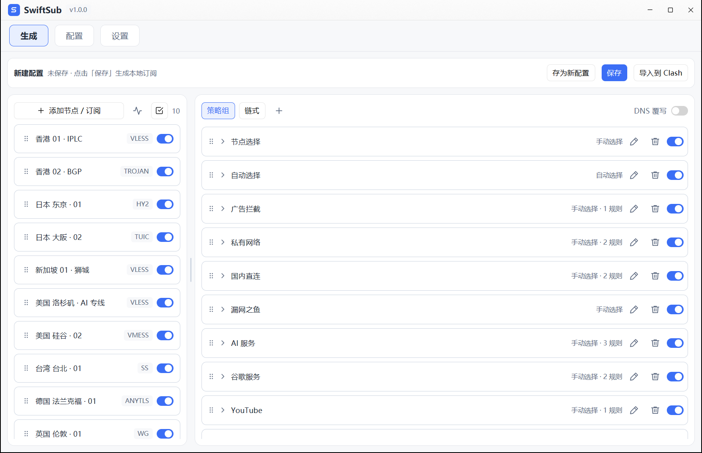
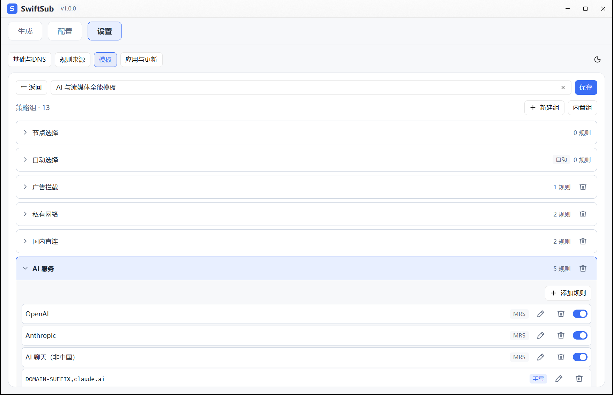
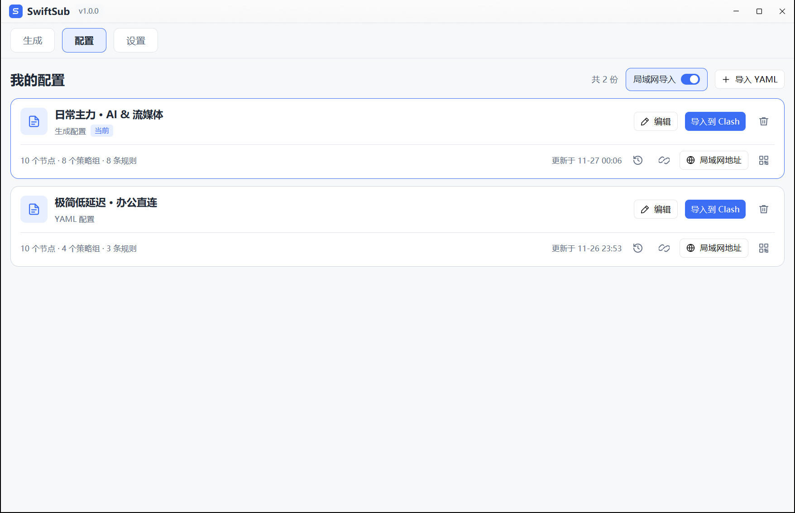
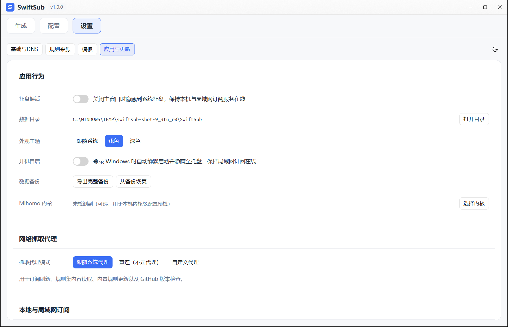
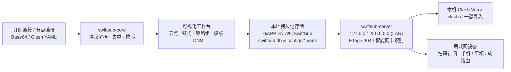

<div align="center">


# SwiftSub

**Local-First Clash / Mihomo & sing-box Subscription Studio and LAN Distribution Server**

*原生 Rust + GPUI 桌面应用 · 纯本地零云端托管 · 全协议 Mihomo 精准转换 · 策略组级模板编排 · 局域网多设备扫码订阅*

[](https://github.com/youbilin/SwiftSub/releases/latest)
[](https://github.com/youbilin/SwiftSub/actions/workflows/validate.yml)
[](rust-toolchain.toml)
[](https://github.com/youbilin/SwiftSub/releases/latest)
[](LICENSE)

[**下载 Windows 安装包 (v1.1.0)**](https://github.com/youbilin/SwiftSub/releases/latest) · [**界面预览**](#-界面预览) · [**核心优势**](#-为什么选择-swiftsub) · [**协议矩阵**](#-协议解析与导出支持) · [**局域网分发**](#-本机与局域网订阅分发) · [**开发构建**](#-工程架构与开发构建)

</div>

---

## 简介

**SwiftSub** 是面向 **Clash Verge / Mihomo** 与 **sing-box** 用户的原生 Windows 桌面端订阅转换、可视化分流编排与局域网分发工作台。

导入机场订阅链接、多行节点分享链接、Base64 订阅或已有 Clash YAML 后，即可在原生图形界面中完成**节点批量运维、链式代理组装、策略组与按组规则编排、多源规则目录管理及完整 DNS 配置**；保存后自动通过内置高并发 HTTP 服务发布为**固定本机与局域网订阅地址**，支持 Clash 一键导入与手机/平板/软路由扫码订阅。

> **零云端 · 零泄露**：所有订阅凭据、节点信息、SQLite 数据库与独立 YAML 配置完全存储在本地 `%APPDATA%\SwiftSub` 目录，**不经过任何第三方转换后端、无账号、无遥测**。

---

## 界面预览

<table>
  <tr>
    <td width="50%">
      <a href="docs/assets/preview-generator.png">
        
      </a>
      <br />
      <sub><strong>主工作台</strong> — 多协议节点侧栏、批量运维、链式代理与实时策略组/规则编排</sub>
    </td>
    <td width="50%">
      <a href="docs/assets/preview-templates.png">
        
      </a>
      <br />
      <sub><strong>独立分流模板编辑器</strong> — 极简手风琴策略组，组内直接管理规则集、链接与手写规则</sub>
    </td>
  </tr>
  <tr>
    <td width="50%">
      <a href="docs/assets/preview-configs.png">
        
      </a>
      <br />
      <sub><strong>我的配置库</strong> — 独立 YAML 持久化、20 版本历史回滚、一键导入与局域网扫码分发</sub>
    </td>
    <td width="50%">
      <a href="docs/assets/preview-settings.png">
        
      </a>
      <br />
      <sub><strong>系统与服务设置</strong> — 跟随系统三态外观、抓取代理、固定端口、私网安全与开机静默自启</sub>
    </td>
  </tr>
</table>

---

## 为什么选择 SwiftSub

| 维度 | 在线订阅转换服务 | 手工维护 Clash YAML | **SwiftSub v1.1** |
|---|---|---|---|
| **节点隐私与安全** | 订阅链接与密钥需上传第三方服务器 | 本地可控 | **100% 本地解析与托管，私网访问拦截，零外泄** |
| **最新协议参数准确性** | 后端更新滞后，易漏参或导错字段 | 手写易拼错、难排查 | **深度对齐 Mihomo Schema，覆盖 REALITY / XHTTP / Hy2 / TUIC / ECH** |
| **模板与规则复用** | 参数拼接繁琐，无法精细调整 | 跨配置复制易断引用 | **独立模板编辑器支持按策略组增删改规则 + 4 大规则源目录 + 环路校验** |
| **多设备订阅分发** | 依赖外网服务稳定性 | 需手动传文件 | **内置多线程 HTTP 服务，智能跳过 TUN/虚拟网卡，支持扫码导入** |
| **安装与运行体验** | 依赖浏览器 / 远端服务 | 需搭配外部编辑器 | **原生 Rust + GPUI，标准 Windows Setup 安装包，低内存占用** |

---

## 工作流一览



---

## 核心功能

### 1. 协议解析与导出支持

SwiftSub 对常见分享链接与 Mihomo Schema 逐项对齐，自动处理 IPv6 地址方括号与字段类型规范化，避免静默丢参：

| 协议 | 支持的分享格式与导出字段 |
|---|---|
| **VLESS** | `REALITY`（`pbk`/`publicKey`、`sid`、`support-x25519mlkem768` 默认开启、显式拦截未支持的 `pqv` 防降级）、`flow`、`encryption`、`packet-encoding`、`XHTTP / SplitHTTP`（`mode`、`extra` / `xmux`）、`WS`（`?ed=` 自动拆分 `max-early-data`）、`HTTPUpgrade`、`gRPC`、`H2`、`HTTP`、`ECH`、`TFO` |
| **Trojan** | 严格输出 Mihomo 规范的 `sni` 字段、完整保留含冒号密码、Trojan `REALITY`、`WS / gRPC / HTTP / H2 / XHTTP`、`alpn`、`client-fingerprint`、`ECH`、`TFO` |
| **Hysteria2** | 兼容 `hy2://` 与 `hysteria2://`、`sni`、自动过滤非法 `obfs=none`、`obfs-password`、纯数字 `up/down` 自动补全 `Mbps`、`ports`/`mport`、`hop-interval`、`cwnd`、`pinSHA256`/`fingerprint`、`alpn`、`ECH`、`TFO` |
| **TUIC** | TUIC v5（`uuid:password`）与 v4（`token`）、`congestion-controller`、`udp-relay-mode`、`sni`、`disable-sni`、`reduce-rtt`、`heartbeat-interval`、`request-timeout`、`alpn`、`client-fingerprint`、`ECH`、`TFO` |
| **Shadowsocks / SSR** | SIP002 & Legacy Base64、`obfs`、`v2ray-plugin`（布尔型 `mux`、`skip-cert-verify`、`fingerprint`）、`shadow-tls`、`restls`、`udp-over-tcp`（`uot`）、`TFO`；SSR 完整协议与混淆参数 |
| **VMess** | 标准 V2RayN JSON 与 Shadowrocket URI、`WS`（含 `?ed=`）、`gRPC`、`H2`、`HTTP`、`XHTTP`、`packet-encoding`、`ECH`、`TFO` |
| **多格式与扩展协议** | `AnyTLS`、`Snell`（v1–v3）、`Hysteria`（v1）、`Juicity`、`WireGuard`（`wg://`）、`SSH`、`HTTP / HTTPS`、`SOCKS4 / SOCKS5`；支持反向导出**单节点分享链接 / 二维码**与 **sing-box 1.11+ JSON**；导入 Clash YAML 原样保留 `mieru`、`masque`、`direct`、`dns`、`reject` 及未知扩展字段 |

### 2. 独立分流模板、批量运维与本地内核预检

- **极简独立模板编辑器**（**设置 → 模板**）：模板与具体节点解耦。支持一键新建、复制内置预设（精简 / 标准 / 完整）或从当前生成页导入；所有策略组（核心组、内置服务组、自定义组及 `DIRECT` / `REJECT`）以手风琴卡片呈现，**点击任意策略组即可直接启停、编辑、改目标或新增该组名下的规则集（规则库搜索 / 自定义链接）与手写规则**。
- **多源规则目录**：内置 MetaCubeX、blackmatrix7、Loyalsoldier、ACL4SSR 常用规则目录，支持 `.mrs` / `.yaml` / `.txt` 正文查看与本地覆写。
- **批量节点运维与分享**：支持对筛选节点批量启用/停用/反转与批量重命名（自动联动策略组与规则引用）；悬停任意节点即可复制分享链接或弹出高清二维码；内置订阅流量进度、临近到期告警与刷新日志面板。
- **链式代理、历史回滚与 Mihomo `-t` 校验**：支持下拉组装多跳链式代理、保存配置最近 20 个版本一键回滚（沿用原订阅地址），以及自动探测本机 Mihomo / Clash Verge 内核执行 `-t` 严格语法校验。
- **完整 DNS 与网络抓取代理**：表单 / YAML 双模式管理 Mihomo `dns`、`hosts` 与测速参数；支持配置全局抓取代理（跟随系统 / 直连 / 自定义 HTTP & SOCKS5 代理）。

### 3. 本机与局域网订阅分发

- **独立持久化订阅 & 高并发服务**：每份配置拥有固定 ID、独立 YAML 文件与订阅地址，内置多线程 HTTP 服务，支持 `ETag` / `If-None-Match`（HTTP 304）、`HEAD` 探测、拉取追踪与一键**重置订阅地址（轮换 Token）**。
- **局域网智能网卡识别、扫码导入与安全护栏**：
  - 支持**固定监听端口**或自动避让冲突端口（`17899–17920`）；默认开启**仅允许私网访问**（RFC1918 / Tailscale，自动 `403` 拦截公网来源）；一键复制 Windows 防火墙放行命令与**手机扫码导入二维码（支持 SVG 导出）**。
  - Windows 原生调用 `GetAdaptersAddresses` 异步评分物理网卡：**自动剔除 Mihomo/Clash TUN 网段（`198.18.0.0/15`）、回环、APIPA 与 VMware / Hyper-V 虚拟网卡**，精准锁定物理 Wi-Fi / 以太网 IP。
- **系统级体验**：按数据目录隔离的单实例互斥锁（重复打开自动唤醒托盘窗口）、关闭到托盘保活、开机静默自启（`--background`）、跟随系统/浅色/深色三态外观，以及完整 SQLite 备份导出与校验预览恢复。

---

## 安装与快速上手

1. **下载安装**：前往 [Releases](https://github.com/youbilin/SwiftSub/releases/latest) 下载安装程序 `SwiftSub-v1.1.0-windows-x64-Setup.exe`，运行安装向导完成安装（支持覆盖升级、桌面/开始菜单快捷方式与系统控制面板干净卸载；用户数据持久化于 `%APPDATA%\SwiftSub`，升级自动保留）。
2. **导入节点**：在 **「生成」** 页左侧点击 **「添加节点 / 订阅」**，粘贴机场订阅地址、多行分享链接或导入 Clash YAML。
3. **编排策略组与模板**：
   - 在 **「设置 → 模板」** 新建或编辑自定义模板，点击任意策略组管理规则后一键 **「应用」**；
   - 在 **「生成」** 页右侧微调策略组、规则或链式节点，按 `Ctrl+S` 或点击 **「保存」**。
4. **多端订阅导入**：
   - **本机**：点击 **「导入到 Clash」** 或复制本机订阅地址 `http://127.0.0.1:<端口>/sub/<ID>/<ID>.yaml`；
   - **手机 / 平板 / 软路由**：开启 **「局域网导入」**，点击二维码图标扫码导入或复制局域网订阅地址。

---

## 工程架构与开发构建

工作区拆分为 5 个职责清晰的 Rust Crate，核心领域逻辑与桌面 UI 完全解耦：

```text
crates/
├── swiftsub-core/     协议解析、节点规范化、策略组/规则引擎、MRS 解码、DNS、YAML & sing-box JSON 生成
├── swiftsub-fetch/    订阅抓取、代理配置、Userinfo 解析、GitHub Releases 更新检查接口
├── swiftsub-store/    SQLite 持久化、Schema 迁移、独立配置文件事务与 20 版本历史回滚
├── swiftsub-server/   高并发本机/局域网 HTTP 订阅服务、私网守卫、ETag 协商、Windows 网卡评分
└── swiftsub-app/      GPUI 0.9.1 桌面端界面、独立模板编辑器、托盘/单实例/自启与内核校验集成
installer/
└── swiftsub.iss       Inno Setup 6 Windows 安装程序脚本
```

### 环境要求

- Windows 10 / 11 x64
- Rust `1.99.0`（[rust-toolchain.toml](rust-toolchain.toml) 已锁定）
- Visual Studio Build Tools（Desktop development with C++）与 Windows SDK
- Inno Setup 6（仅构建安装程序 `Setup.exe` 时需要）

### 构建与质量验证

```powershell
# 代码格式与严格 Clippy 检查
cargo fmt --all -- --check
.\scripts\cargo-msvc.bat clippy --workspace --all-targets --locked -- -D warnings

# 运行全部单元测试与集成测试
.\scripts\cargo-msvc.bat test --workspace --locked

# 构建 Release 主程序（启用 thin LTO 与符号剥离）
.\scripts\cargo-msvc.bat build --release --locked -p swiftsub-app

# 打包 Windows 安装程序（输出 dist\SwiftSub-v1.1.0-windows-x64-Setup.exe）
iscc /DMyAppVersion=1.1.0 installer\swiftsub.iss
```

GitHub Actions 工作流（[.github/workflows/validate.yml](.github/workflows/validate.yml) 与 [.github/workflows/release.yml](.github/workflows/release.yml)）自动执行格式化校验、严格 Clippy、全量测试、100 节点预设基准生成、**真实 Mihomo 内核配置校验**、桌面启动/重启冒烟测试以及 Windows 安装包自动化发布。

---

## 隐私、安全与许可

- **隐私边界**：除用户主动点击刷新订阅、更新规则源或检查更新外，程序不发起任何外部网络连接；默认仅监听 `127.0.0.1`，开启「局域网导入」后默认仅允许私网与虚拟组网地址访问。
- **免责声明**：本项目仅提供本地配置转换、规则编排与局域网分发工具，不提供任何代理节点或网络转发服务。
- **开源许可**：采用 [Apache License 2.0](LICENSE) 开源。部分产品交互思路参考 [SubBoost](https://github.com/SubBoost/subboost)（AGPL-3.0），本仓库为完全独立实现，不包含其任何源代码或资源。
