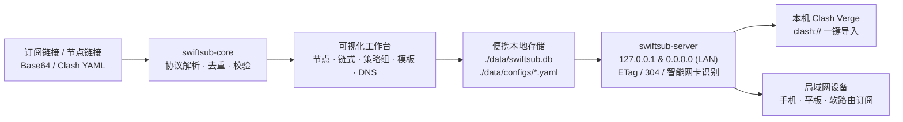

<div align="center">


# SwiftSub

**Local-First Clash / Mihomo Subscription Converter, Visual Routing Studio & LAN Distribution Server**

*原生 Rust + GPUI 构建 · 纯本地便携零云端 · 多协议最新参数精准转换 · 一键局域网多设备订阅分发*

[](https://github.com/youbilin/SwiftSub/releases/latest)
[](https://github.com/youbilin/SwiftSub/actions/workflows/validate.yml)
[](rust-toolchain.toml)
[](https://github.com/youbilin/SwiftSub/releases)
[](LICENSE)

[**下载最新版本 (Releases)**](https://github.com/youbilin/SwiftSub/releases/latest) · [**核心优势**](#-为什么选择-swiftsub) · [**协议支持矩阵**](#-协议解析与-mihomo-导出支持) · [**局域网分发**](#-本机与局域网订阅分发) · [**架构与构建**](#-工程架构与开发构建)

</div>

---

## 简介

**SwiftSub** 是一款为 **Clash Verge / Mihomo** 用户打造的原生桌面端订阅转换与分流编排工作台。

只需导入机场订阅链接、节点分享链接、Base64 文本或已有 Clash YAML，即可在图形界面中完成**节点编辑、链式代理组装、策略组编排、规则目录订阅与 DNS 精细配置**，并通过内置 HTTP 服务将每份配置发布为**固定本机与局域网订阅地址**，供本机客户端及同局域网的手机、平板、软路由随时拉取更新。

> **便携 & 零泄露**：所有订阅凭据、节点信息、数据库与生成的 YAML 配置文件默认保存在程序同级 `data/` 目录中，**不经过任何第三方转换后端、无账号、无遥测**。

---

## 为什么选择 SwiftSub

| 维度 | 在线订阅转换服务 | 手工维护 Clash YAML | **SwiftSub** |
|---|---|---|---|
| **节点隐私与安全** | 订阅链接与密钥需上传第三方服务器 | 本地可控 | **100% 本地解析与托管，零节点外泄** |
| **最新协议参数准确性** | 后端更新滞后，易漏参或导错字段 | 手写易拼错、难排查 | **针对 Mihomo 深度校对，支持 REALITY / XHTTP / Hy2 / TUIC / ECH** |
| **规则与模板复用** | 参数拼接繁琐，难以微调 | 跨配置复制易断引用 | **内置独立分流模板编辑器 + 4 大规则源目录 + 引用/环路校验** |
| **多设备订阅更新** | 依赖外网服务稳定性 | 需手动传文件 | **内置本机 + 局域网 HTTP 服务，智能跳过 TUN/虚拟网卡** |
| **便携与启动开销** | 浏览器 / 服务端依赖 | 需搭配编辑器 | **Rust + GPUI 单文件原生便携，数据默认存放在同目录 `data/`** |

---

## 工作流一览



---

## 核心功能

### 1. 协议解析与 Mihomo 导出支持

SwiftSub 对常见分享链接与 Mihomo Schema 逐项对齐，避免导入导出时出现字段名错配、类型不兼容或静默丢参，并自动处理 IPv6 地址方括号：

| 协议 | 支持的分享格式与 Mihomo 导出字段 |
|---|---|
| **VLESS** | `REALITY`（`pbk`/`publicKey`、`sid`、`support-x25519mlkem768` 默认开启、显式拦截 Mihomo 尚不支持的 `pqv` 防降级）、`flow`、`encryption`、`packet-encoding`、`XHTTP / SplitHTTP`（`mode`、`extra` / `xmux` 完整映射与回退）、`WS`（`?ed=` Early Data 自动拆分 `max-early-data`）、`HTTPUpgrade`、`gRPC`、`H2`、`HTTP`、`ECH`、`TFO` |
| **Trojan** | 严格输出 Mihomo 规范的 `sni` 字段（而非被忽略的 `servername`）、完整保留含冒号密码、Trojan `REALITY`、`WS / gRPC / HTTP / H2 / XHTTP`、`alpn`、`client-fingerprint`、`ECH`、`TFO` |
| **Hysteria2** | 兼容 `hy2://` 与 `hysteria2://`、`sni`、自动过滤非法 `obfs=none`、`obfs-password`、纯数字 `up/down` 自动补全 `Mbps` 单位、`ports`/`mport`、`hop-interval`、`cwnd`、`pinSHA256`/`fingerprint`、`alpn`、`ECH`、`TFO` |
| **TUIC** | TUIC v5（`uuid:password`）与 v4（`token`）、`congestion-controller`、`udp-relay-mode`、`sni`、`disable-sni`、`reduce-rtt`、`heartbeat-interval`、`request-timeout`、`alpn`、`client-fingerprint`、`ECH`、`TFO` |
| **Shadowsocks / SSR** | SIP002 & Legacy Base64、`obfs`、`v2ray-plugin`（布尔型 `mux`、`skip-cert-verify`、`fingerprint`）、`shadow-tls`、`restls`、`udp-over-tcp`（`uot`）、`TFO`；SSR 完整协议与混淆参数 |
| **VMess** | 标准 V2RayN JSON 与 Shadowrocket URI 格式、`WS`（含 `?ed=`）、`gRPC`、`H2`、`HTTP`、`XHTTP`、`packet-encoding`、`ECH`、`TFO` |
| **其他与 Clash YAML** | `AnyTLS`、`Snell`（v1–v3）、`Hysteria`（v1）、`Juicity`、`WireGuard`（`wg://`）、`SSH`、`HTTP / HTTPS`、`SOCKS4 / SOCKS5`（支持 Base64 凭据与 TLS/SNI）；支持反向导出单节点分享链接与 **sing-box 1.11+ JSON**；导入 Clash YAML 原样保留 `mieru`、`masque`、`direct`、`dns`、`reject` 及未知扩展字段 |

### 2. 独立分流模板、批量运维与内核校验
- **独立模板编辑器**（**设置 → 模板**）：模板仅定义**策略组与分流规则结构（不含具体节点）**。可在模板页直接新建、复制内置预设（精简 / 标准 / 完整）或编辑自定义模板，勾选内置服务模块、增删自定义策略组（`手动选择 / 自动选择 / 故障转移 / 负载均衡`）、绑定自定义规则集链接与手写规则，不干扰当前生成页节点。
- **多源规则目录**：集成 MetaCubeX、blackmatrix7、Loyalsoldier、ACL4SSR 常用规则目录，支持 `.mrs` / `.yaml` / `.txt` 正文预览与本地覆写。
- **批量节点运维与单节点分享**：生成页支持对当前筛选节点批量启用/停用/反转与批量重命名（自动联动策略组与规则引用）；悬停任意节点即可一键复制分享链接或弹出高清二维码；内置订阅流量进度/临近到期告警与刷新日志面板。
- **链式代理、历史回滚与本地内核校验**：支持下拉组装链式代理、保存配置最近 20 个历史版本一键回滚（沿用原订阅地址），以及自动探测本机 Mihomo / Clash Verge 内核执行 `-t` 严格语法校验。
- **完整 DNS、测速与网络抓取代理**：表单与 YAML 双模式管理 Mihomo `dns`、`hosts` 与测速参数；设置页支持配置全局抓取代理（跟随系统 / 直连 / 自定义 HTTP & SOCKS5 代理），统一接管订阅刷新、规则更新与版本检查。

### 3. 本机与局域网订阅分发
- **独立持久化订阅 & 高并发服务**：每份保存的配置拥有固定 ID、独立 YAML 文件与订阅地址，内置多线程 HTTP 订阅服务，支持 `ETag` / `If-None-Match`（HTTP 304）、`HEAD` 探测、拉取时间追踪与一键**重置订阅地址（轮换 Token）**。
- **局域网智能网卡识别、二维码与私网安全**：
  - 开启「局域网导入」后支持**自定义固定端口**或自动避让冲突端口（`17899–17920`），默认开启**仅允许私网访问**（RFC1918 / Tailscale，自动 `403` 拦截公网来源），并提供一键复制 Windows 防火墙放行命令与**手机扫码导入二维码（支持 SVG 导出）**。
  - Windows 原生调用 `GetAdaptersAddresses` 异步探测并缓存物理网卡评分：**自动剔除 Mihomo/Clash TUN 网段（`198.18.0.0/15`）、回环、APIPA 与 VMware / Hyper-V 虚拟网卡**，精准命中真实物理 Wi-Fi / 以太网 IP，并支持手动切换网卡。
- **单实例保护、开机静默自启与完整备份恢复**：按数据目录隔离的 Windows 单实例互斥锁（重复启动自动唤醒托盘窗口）；支持关闭到托盘保活、开机静默自启（`--background`）、跟随系统/浅色/深色三态外观，以及完整 SQLite 一致性备份导出与校验预览恢复。

---

## 便携数据目录结构

SwiftSub 默认采用**便携模式**，所有本地数据直接保存在可执行文件同级的 `data/` 目录下（若所在目录只读，例如 `Program Files`，则自动回退到 `%APPDATA%\SwiftSub`，也支持通过环境变量 `SWIFTSUB_DATA_DIR` 指定自定义路径）：

```text
SwiftSub/
├── swiftsub.exe                  # 单文件便携主程序
└── data/
    ├── swiftsub.db               # SQLite 数据库（订阅源、节点覆写、自定义模板、应用设置）
    ├── configs/
    │   └── <config-id>.yaml      # 每份配置对应的独立 Mihomo YAML 文件
    └── rules_cache/              # 规则集本地缓存
```

---

## 快速上手

1. **下载运行**：前往 [Releases](https://github.com/youbilin/SwiftSub/releases/latest) 下载 `swiftsub-vX.Y.Z-windows-x64.exe`，放入任意文件夹双击运行即可。
2. **导入节点**：在 **「生成」** 页左侧点击 **「添加节点 / 订阅」**，粘贴机场订阅地址、多行分享链接或导入已有 Clash YAML。
3. **编排配置**：
   - 如需复用分流方案，可在 **「设置 → 模板」** 新建/编辑自定义模板并点击 **「应用」**；
   - 在 **「生成」** 页右侧微调策略组、规则或创建链式节点，点击顶部 **「保存」**。
4. **导入客户端**：
   - **本机**：点击 **「导入到 Clash」** 或复制本机订阅地址 `http://127.0.0.1:<端口>/sub/<ID>/<ID>.yaml`；
   - **局域网设备（手机 / 平板 / 软路由）**：在 **「配置」** 页或 **「设置 → 应用与更新」** 开启 **「局域网导入」**，复制局域网订阅地址（若其他设备无法访问，请在 Windows 防火墙放行 `swiftsub.exe`）。

---

## 工程架构与开发构建

工作区拆分为 5 个职责清晰的 Rust Crate，核心领域逻辑与桌面 UI 完全解耦：

```text
crates/
├── swiftsub-core/     协议解析、节点规范化、策略组/规则引擎、MRS 解码、DNS 与 YAML 生成
├── swiftsub-fetch/    订阅抓取、代理配置、Userinfo 解析、GitHub Releases 更新检查接口
├── swiftsub-store/    SQLite 持久化、Schema 迁移、独立配置文件事务与外部修改保护
├── swiftsub-server/   本机/局域网 HTTP 订阅服务、ETag 缓存协商、Windows 网卡智能探测
└── swiftsub-app/      GPUI 0.9.1 桌面端界面、独立模板编辑器、Windows 图标/托盘/URI 集成
```

### 环境要求
- Windows 10 / 11 x64
- Rust `1.99.0`（[rust-toolchain.toml](rust-toolchain.toml) 已锁定）
- Visual Studio Build Tools（Desktop development with C++）与 Windows SDK

### 构建与质量验证

```powershell
# 代码格式与严格 Clippy 检查
.\scripts\cargo-msvc.bat fmt --all -- --check
.\scripts\cargo-msvc.bat clippy --workspace --all-targets --locked -- -D warnings

# 运行全部单元测试与集成测试（166+ 用例）
.\scripts\cargo-msvc.bat test --workspace --locked

# 构建 Release 便携可执行文件（启用 thin LTO 与符号剥离）
.\scripts\cargo-msvc.bat build --release --locked -p swiftsub-app
# 输出: target\release\swiftsub.exe
```

GitHub Actions 工作流（[.github/workflows/validate.yml](.github/workflows/validate.yml)）在每次推送时自动执行格式化校验、严格 Clippy、全量测试、100 节点预设基准生成、**真实 Mihomo 内核配置校验**以及桌面端 Release 构建。

---

## 隐私、安全与许可

- **隐私边界**：除用户主动点击刷新订阅、更新规则源或检查更新（请求 GitHub Releases API）外，程序不发起任何外部网络连接；默认仅绑定 `127.0.0.1`，仅在显式开启「局域网导入」时监听 `0.0.0.0`。
- **免责声明**：本项目仅提供本地配置转换、规则编排与局域网分发工具，不提供任何代理节点或网络转发服务。
- **开源许可**：本项目采用 [Apache License 2.0](LICENSE) 开源。部分产品交互思路参考 [SubBoost](https://github.com/SubBoost/subboost)（AGPL-3.0），本仓库为完全独立实现，不包含其任何源代码或资源。
